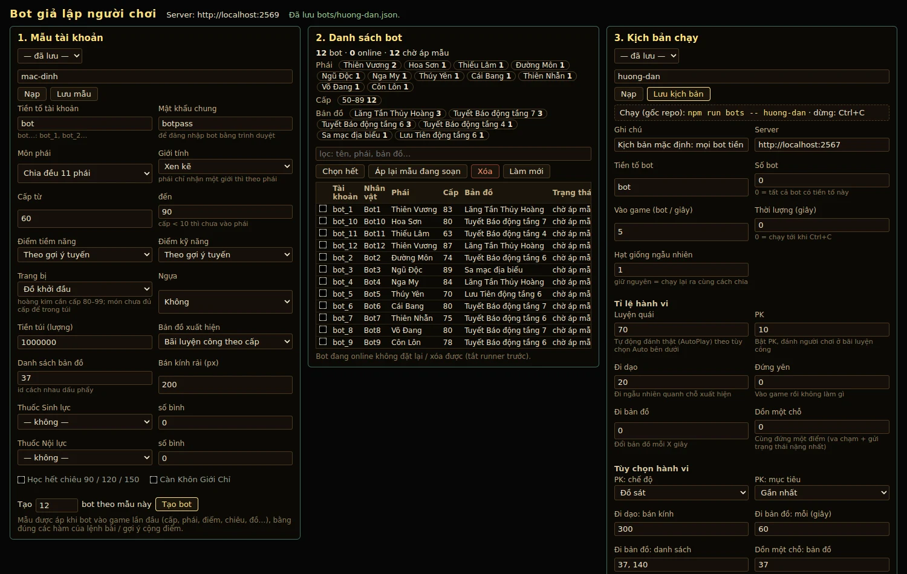
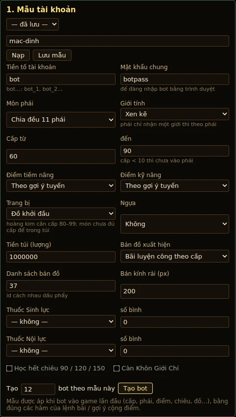
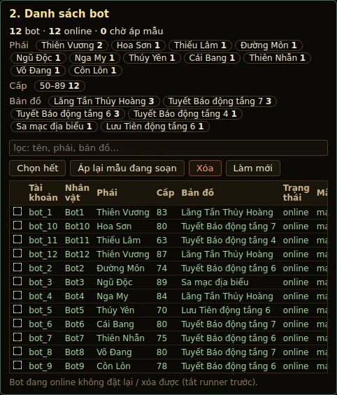
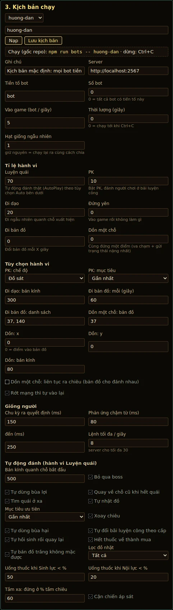

# Hướng dẫn dùng bot

Bot là tài khoản thật vào game như người chơi. Bạn soạn trên trang `/?bots` rồi chạy bằng một lệnh. Thiết kế và mã nguồn ở
[`bots.md`](bots.md).

```
1. Mẫu tài khoản  →  Tạo bot          (một lần: bot là ai — cấp, phái, đồ)
2. Danh sách bot  →  xem / áp lại / xóa
3. Kịch bản chạy  →  Lưu kịch bản     (bot làm gì khi vào game)
   npm run bots -- <tên kịch bản>      (chạy; Ctrl+C để dừng)
```

## 0. Chuẩn bị

- Chạy `npm run dev` như thường, rồi mở `http://localhost:5173/?bots`. Trang này không cần đăng nhập.
- Server phải bật `DEV_TOOLS`. Mặc định là bật; `DEV_TOOLS=0` thì tắt.
- API bot chỉ nhận yêu cầu từ chính máy chạy server, và chỉ đụng tới tài khoản bot.
- Server khác `:2567` thì thêm `&server=http://host:port` vào địa chỉ.



## 1. Mẫu tài khoản: tạo bot



1. Chọn mẫu đã lưu rồi bấm **Nạp**, hoặc chỉnh trực tiếp trên form.
2. Nếu muốn dùng lại mẫu, đặt tên rồi bấm **Lưu mẫu**. Mẫu lưu ở `bots/templates/<tên>.json`.
3. Nhập số bot, bấm **Tạo bot**. Tên tài khoản là `<tiền tố>_1`, `_2`…, mật khẩu là "Mật khẩu chung". Bạn có thể đăng nhập một bot
   bằng trình duyệt để xem nó làm gì.

| Ô | Ý nghĩa |
|---|---|
| Môn phái | Một phái, **chia đều 11 phái**, hoặc chưa vào phái. Cấp dưới 10 thì chưa vào phái được |
| Cấp từ – đến | Mỗi bot lấy ngẫu nhiên một cấp trong khoảng này |
| Điểm tiềm năng / kỹ năng | Cộng theo gợi ý tuyến, hoặc dồn vào một thuộc tính |
| Trang bị | Đồ khởi đầu, hoặc bộ hoàng kim môn phái. Bộ hoàng kim cần cấp 80–99; món chưa đủ cấp để trong túi |
| Ngựa | Không có / ngẫu nhiên trong số ngựa cưỡi được ở cấp đó / một loại cố định |
| Bản đồ xuất hiện | Bãi luyện công theo cấp / thành / chia đều vào **danh sách bản đồ** (id cách nhau dấu phẩy) |
| Học hết chiêu 90 / 120 / 150, Càn Khôn Giới Chỉ | Như dùng lệnh bài |

Mẫu được áp **khi bot vào game lần đầu**. Trước đó cột Trạng thái ghi "chờ áp mẫu".

## 2. Danh sách bot



- Dòng trên cùng đếm số bot theo phái, cấp và bản đồ. Bảng tự làm mới mỗi 5 giây; bot đang online hiện màu xanh.
- **Lọc**: gõ tên, phái hoặc bản đồ. **Chọn hết**: chọn mọi dòng đang hiện.
- **Áp lại mẫu đang soạn**: bot đã chọn về cấp 1, giữ tên, rồi nhận mẫu đang soạn ở mục 1 vào lần vào game tới.
- **Xóa**: xóa hẳn tài khoản và nhân vật.
- Bot đang online thì không áp lại hay xóa được. Dừng lệnh `npm run bots` trước.

## 3. Kịch bản chạy



Đặt tên, chỉnh các ô, bấm **Lưu kịch bản** (lưu ở `bots/<tên>.json`). Trang hiện sẵn lệnh để chạy kịch bản đó.

**Chung**

| Ô | Ý nghĩa |
|---|---|
| Server | Server bot sẽ vào |
| Tiền tố bot, Số bot | Dùng những bot nào. Số bot 0 = mọi bot có tiền tố đó |
| Vào game (bot / giây) | Mỗi giây cho bao nhiêu bot vào game, để không đăng nhập dồn một lúc |
| Thời lượng | Chạy bao nhiêu giây. 0 = chạy tới khi bấm Ctrl+C |
| Hạt giống ngẫu nhiên | Giữ nguyên số này thì lần chạy sau mỗi bot nhận lại đúng hành vi cũ |

**Tỉ lệ hành vi**: mỗi bot được giao **một** kiểu và giữ kiểu đó suốt lần chạy. Các số là **trọng số**, không cần cộng lại bằng 100;
đặt 0 là không dùng kiểu đó. Ví dụ 50 bot với Luyện quái 70, PK 10, Đi dạo 20 → 35 bot luyện quái, 5 bot PK, 10 bot đi dạo.

| Kiểu | Bot làm gì |
|---|---|
| Luyện quái | Chạy Auto phím Z thật, theo các ô "Tự động đánh": đánh quái, uống thuốc, nhặt đồ, về thành mua thuốc, hồi sinh, đổi bãi theo cấp |
| PK | Tự đi bãi luyện công hợp cấp, bật PK, săn người chơi. Bot chưa vào phái không PK được nên chỉ đi dạo |
| Đi dạo | Cứ 2–6 giây đi tới một điểm ngẫu nhiên quanh chỗ xuất hiện |
| Đứng yên | Vào game rồi đứng đó, chết thì hồi sinh |
| Đi bản đồ | Đổi sang một bản đồ trong danh sách mỗi X giây (lệch ±20 %) |
| Dồn một chỗ | Mọi bot tụ về một điểm. Đây là trường hợp nặng nhất cho server; có thể bật thêm "liên tục ra chiêu" |

**Tùy chọn hành vi**: mỗi ô chỉ có tác dụng với kiểu tương ứng.

| Ô | Ý nghĩa |
|---|---|
| PK: chế độ | Đồ sát = đánh mọi người; Chiến đấu = chỉ đánh người khác phe |
| PK: mục tiêu | Gần nhất / khác phe / ngẫu nhiên. Giữ một mục tiêu tối đa 20 giây, không đánh người cùng đội |
| Đi dạo: bán kính | Đi xa chỗ xuất hiện tối đa bao nhiêu |
| Đi bản đồ | Đổi bản đồ mỗi bao nhiêu giây, và đi giữa những bản đồ nào. Bản đồ chưa sinh asset thì server từ chối |
| Dồn một chỗ | Bản đồ, tọa độ x / y (0 = điểm vào bản đồ), bán kính tụ |
| Rớt mạng thì tự vào lại | Mất kết nối thì 3–8 giây sau tự vào lại |

**Giống người**: giới hạn để bot không gửi lệnh nhanh hơn người thật, nhờ vậy tải lên server giống người chơi thật.

| Ô | Ý nghĩa |
|---|---|
| Chu kỳ ra quyết định | Bao nhiêu ms bot mới "nhìn" lại và quyết định một lần (lệch ±30 %) |
| Phản ứng chậm từ – đến | Mỗi lệnh chờ thêm một khoảng ngẫu nhiên trong dải này rồi mới gửi, như thời gian tay bấm. Lệnh vẫn đi đúng thứ tự |
| Lệnh tối đa / giây | Trong 1 giây, lệnh vượt quá số này **bị bỏ** (cột "dropped" khi chạy) |

**Tự động đánh**: giống hệt cửa sổ Auto trong game, chỉ dùng cho kiểu Luyện quái.

## 4. Chạy

```bash
npm run bots -- huong-dan                                   # theo bots/huong-dan.json
npm run bots -- huong-dan --server http://localhost:2568    # đổi server, không sửa file
npm run bots -- 4 60                                        # chế độ cũ: 4 bot, 60 giây, thử nhanh
```

Cứ 10 giây, lệnh in một dòng trạng thái. Ví dụ thật (12 bot):

```
[bots] kịch bản "huong-dan" · http://localhost:2569 · 12 bot (Luyện quái 9, PK 1, Đi dạo 2) · vào 5 bot/giây · chạy tới khi Ctrl+C
[bots 17:04:18] online 12/12 · bản đồ 37:3 151:3 8:2 150:2 224:1 130:1 · lệnh/s 8 · chết 2 · đổi bản đồ 7 · vào lại 0 · lỗi 0
```

`bản đồ 37:3` nghĩa là 3 bot đang ở bản đồ 37. "Đổi bản đồ" tăng khi bot về thành mua thuốc / hồi sinh rồi quay lại bãi luyện.

## 5. Lưu ý

- **Giới hạn bản đồ:** "Danh sách bản đồ" ở mục 1 chỉ quyết định **chỗ xuất hiện**.
  - Luyện quái (khi bật "Tự đổi bãi luyện công theo cấp") và PK vẫn tự đi bãi luyện công theo cấp.
  - Chết thì hồi sinh về thành.
  - Chưa có ô "chỉ hoạt động ở các bản đồ…" trong kịch bản; ô này mới là đề xuất.
- Bot chưa tự cộng điểm khi lên cấp, chưa mặc đồ nhặt được, chưa có hành vi tổ đội / chat (BACKLOG BT8).
- Số đo hiệu năng server (tick, CPU, RAM, băng thông) là **phần 2**, chưa làm (`bots.md` §3).
- Sửa tay file JSON cũng được: trường thiếu hoặc sai sẽ lấy giá trị mặc định.
