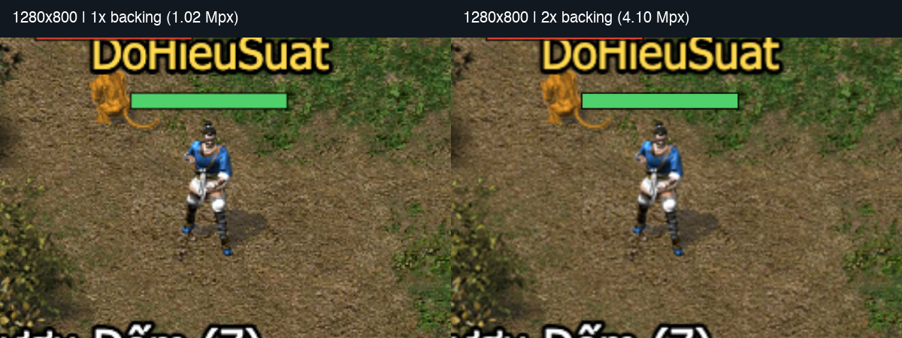

# 02 — PF1: Đo lường (làm đầu tiên)

> Mục tiêu: có **số liệu gốc** trước khi chỉnh, và một cách đo lặp lại được để so trước / sau mỗi bước PF2–PF4.
> Không đổi hành vi game. Mọi mã đo nằm trong `apps/client/src/dev/` (nạp động, bản build chính thức không chứa — `AGENTS.md` §6).

## 1. Đo cái gì

| Chỉ số | Cách lấy | Vì sao |
|---|---|---|
| Byte tải về theo loại (`maps`, `char`, `npc`, `skill`, `items`, `ui`, `sound`, `music`, `js`) | `PerformanceObserver({ type: 'resource' })`, `entry.transferSize` / `encodedBodySize`, phân loại theo đường dẫn | Biết loại nào nặng nhất |
| Số request, số request đang chờ | như trên + độ dài hàng đợi `MapView` / Phaser loader | Biết có nghẽn hàng đợi không |
| Bộ nhớ texture ước tính | duyệt `game.textures.list`, cộng `source.width × source.height × 4` mỗi texture, nhóm theo tiền tố khóa (`jx:`, `fx:`, `map<id>-g-`, `map<id>-o-`, `gnd:`, icon) | Ngân sách PF2 |
| Số texture, số sheet nhân vật / quái | như trên | |
| Thời gian các mốc | `performance.mark`: `app-start`, `login-ok`, `boot-done`, `map-ready` (sau `map.ready`), `world-built` (cuối `build()`), `first-self-drawn` (lần đầu `JxSprite.render` của mình trả `true`) | Ngân sách thời gian G0–G2 |
| Khung hình | FPS trung bình + số khung > 50 ms trong 10 s gần nhất | Phát hiện giật do giải mã ảnh |
| Heap JS | `performance.memory.usedJSHeapSize` (chỉ Chromium) | |
| Cache hit (sau PF4) | `transferSize === 0` ⇒ lấy từ cache | Đo hiệu quả PF4 |

## 2. Triển khai

1. **Mốc thời gian** — thêm `performance.mark(...)` ở: `app/App.ts` (đăng nhập xong, trước `bootGame`, trước vào bản đồ),
   `game/WorldScene.ts` (sau `map.ready`, cuối `build()`), `game/actors/ActorView.ts` (lần đầu vẽ được chính mình). `performance.mark`
   gần như không tốn gì, để luôn trong bản build cũng được (không phải mã dev).
2. **Bộ thu số liệu** `apps/client/src/dev/perf/collect.ts`:
   - `PerformanceObserver` gom resource entries; `performance.setResourceTimingBufferSize(5000)` để không bị cắt ở 250 mục.
   - `textureStats(game)` trả `{ count, bytes, byPrefix }`. Cần lấy `Phaser.Game` qua `game/index.ts` (đã có `window.__vltk.game()` ở bản dev).
   - `snapshot()` trả một object JSON gồm mọi chỉ số ở §1.
3. **Bảng hiển thị** `apps/client/src/dev/perf/overlay.ts` (+ `.css`): khung chữ nhỏ góc phải, cập nhật mỗi giây; bật bằng tham số
   `?perf` hoặc một phím chỉ có ở bản dev (khai báo trong `input/keymap.ts` như các phím dev khác). Nút "Sao chép JSON" (`snapshot()`).
   Đăng ký trong `dev/index.ts` (nạp động).
4. **Đưa ra cho Playwright**: `window.__vltk.perf = { snapshot }` ở bản dev.
5. **Kịch bản đo** `apps/client/tools/perf/run.ts` (hoặc `scripts/`; liên quan HT8 — đưa Playwright vào repo):
   - Chạy trên server thử nghiệm `:2568` / `:5174` (`tasks/CURRENT.md` §6), tài khoản mới trong `DB_PATH` tạm.
   - Các bước: mở trang → đăng nhập → tạo nhân vật → vào Biện Kinh (37) → đứng 10 s → đi một vòng (gửi lệnh `move` qua `room()`) →
     sang Dược Vương Cốc (140) qua cổng hoặc lệnh dev → bật Auto 60 s → lấy `snapshot()` sau mỗi bước.
   - Hai chế độ mạng bằng CDP `Network.emulateNetworkConditions`: không giới hạn, và "4G chậm" (≈ 4 Mbps, 150 ms).
   - Ghi kết quả JSON vào scratchpad + in bảng tóm tắt.
6. **Ghi số liệu gốc** vào `docs/performance/02-do-luong.md` §4 (bảng dưới), kèm commit và ngày đo.

## 3. Ngân sách đề xuất (chốt sau khi có số gốc)

| Chỉ số | Desktop | Mobile |
|---|---|---|
| G0 (mở trang tới màn đăng nhập), 4G chậm | ≤ 4 s | ≤ 6 s |
| G2 (bấm vào bản đồ tới thấy mình đứng), 4G chậm, cache trống | ≤ 4 s | ≤ 6 s |
| G2 khi cache đầy (PF4) | ≤ 1,5 s | ≤ 2 s |
| Bộ nhớ texture sau 10 phút chơi, 3 lần đổi bản đồ | ≤ 512 MB | ≤ 192 MB |
| Khung > 50 ms khi đi bộ trong thành | ≤ 1 / 10 s | ≤ 3 / 10 s |

## 4. Số liệu gốc

### 4.1 Trace render ngày 2026-11-14 — điều tra 2026-11-15

Nguồn: `/Users/hudy/Downloads/Trace-20261114T210657.json`, 65.389 sự kiện;
SHA-256 `31fc78e9c6ed4eb443ec6338747d1ea18af960bf224b043c576178ef1c940655`.
Trace bắt đầu lúc **21:06:57 ngày 2026-11-14, giờ Việt Nam**, Chrome DevTools, trang `localhost:5173`.
Mã đối chiếu ngày 2026-11-15: **`727a7e1`**, khác thời điểm ghi trace; chưa biết chính xác commit của phiên trace.
Đây là phép đo bổ sung cho PF1, **chưa hoàn tất PF1** (chưa có overlay, số tải/cache trống/đầy và hai chế độ mạng).

| Chỉ số | Đo lại trực tiếp từ JSON |
|---|---|
| Khoảng ghi | 8,135332 giây |
| Nhịp frame | 139 `FireAnimationFrame` ≈ **17,09 FPS**; có 139 `DrawFrame` |
| Khoảng giữa hai rAF | Trung vị **57,944 ms**, p95 **62,399 ms** (nearest-rank); 135/138 khoảng >33 ms |
| Thời lượng callback rAF | Bỏ frame đầu chứa profiler: trung vị **2,453 ms**, p95 **2,797 ms**, lớn nhất **3,033 ms** |
| Luồng chính renderer | `RunTask` tổng **881,821 ms** thời gian thực, gồm task khởi động profiler **274,486 ms** |
| Profiler | `CpuProfiler::StartProfiling` **270,562 ms**, nằm trong task dài đầu trace; không gán task này cho gameplay |
| GC | 4 `MinorGC`, tổng **2,491 ms** |
| Luồng chính tiến trình GPU | `RunTask`: **7.978,341 ms thời gian thực**, nhưng **1.433,257 ms thời gian CPU của thread** |
| `GPUTask` gắn renderer game PID96230 | Tổng **7.465,619 ms thời gian thực**, **1.128,850 ms thời gian CPU của thread**; bỏ sự kiện `B` cuối chưa có kết thúc |
| Bộ nhớ do `GPUTask` báo cho renderer game | **479.854.968 → 290.740.092 byte**; không mặc định coi là toàn bộ texture/VRAM vật lý |
| Viewport trong trace | `PaintTimingVisualizer::Viewport`: **1500×1001 CSS px, DPR2**; `Paint`/`Layout` có quad **3000×2002** |
| Backing dự kiến theo mã hiện tại | `innerWidth×DPR`, `innerHeight×DPR` → **3000×2002 = 6.006.000 pixel/frame**; kiểm chứng bằng Chromium riêng cho đúng kích thước này ở §7 |

**Kết luận:** dấu hiệu mạnh cho thấy giới hạn ở đường đồ họa/driver/trình bày frame; JS trên luồng chính và GC không giải thích được khoảng frame ~58 ms.
Chưa có bộ đếm phần cứng hoặc GPU timer để kết luận GPU ALU/fill-rate/băng thông nào là nút thắt cụ thể.
Không được diễn giải thời gian thực `GPUTask` thành **98% mức sử dụng GPU phần cứng**, hoặc coi tổng đó là thời gian GPU thực thi mỗi frame.
CPU thread có thể chờ trong khoảng sự kiện. Không suy ra số draw call từ thời gian WebGL phía JS trong CPU profile.

### 4.2 Các giả thuyết còn thiếu A/B

- Canvas theo DPR và yêu cầu antialias đã xác minh bằng mã; **mức ảnh hưởng riêng của pixel/MSAA chưa đo A/B trên cảnh game**.
- Phaser **4.2.1** mặc định `antialiasGL=true`, `powerPreference='default'`; `game/index.ts` không ghi đè.
  Chromium riêng ở §7 thực tế tạo context `antialias=true`, `SAMPLES=4`; **đây không phải phép đo context của phiên trace cũ**.
  Theo [đặc tả WebGL](https://registry.khronos.org/webgl/specs/latest/1.0/), yêu cầu antialias không ấn định một mức MSAA4× cho mọi thiết bị.
- Trace không xác định GPU tích hợp/rời; không kết luận máy có hai GPU hoặc đổi `powerPreference` chắc chắn tăng FPS.
- Bộ nhớ giảm trong trace không chứng minh rò rỉ. Việc chưa có LRU sheet trong mã là một vấn đề quản lý tài nguyên riêng (§7).
- Tài liệu `06-render-gpu-va-chuyen-dong.md` là kế hoạch chưa triển khai, có sẵn nhưng untracked đầu lượt.
  Các bước làm và bảng ghi quyết định trong đó **không được coi là yêu cầu/phê duyệt triển khai của lượt điều tra này**.
  Đọc lại các khẳng định GPU98%, MSAA4× và “ít draw call” theo giới hạn ở trên; các ví dụ màn 3456×2234 không phải kích thước viewport của trace này.

## 5. Kiểm chứng

- `npm run typecheck`; bản build (`npx vite build` cấu hình tạm như `tasks/CURRENT.md` §6) không chứa `dev/perf` (tìm chuỗi `perf-overlay`
  trong `dist`).
- Số byte của overlay khớp tab Network của Chrome DevTools trong một lần thử tay.

## 6. Ba nền tảng

`PerformanceObserver`, `performance.mark` có ở Chromium (Web, Electron, Android WebView) và WebKit (Safari, iOS, Tauri macOS).
`performance.memory` chỉ có ở Chromium; trên WebKit để trống. Đo trên điện thoại thật: mở `?perf` trên mạng LAN tới server thử.

## 7. Xác minh culling và phương án 1–2 viewport cố định (2026-11-15)

### 7.1 Kết quả đối chiếu mã

| Nhóm | Hiện trạng đã xác minh | Hệ quả |
|---|---|---|
| Nền đất | `MapView.ensure` tải region quanh view +384 px, `evict` giữ tới +1400 px; `cull` chỉ duyệt `chunks`, không duyệt `regions`; `loadRegion` tạo Image visible | Có streaming nhưng **chưa cull render ground theo camera**. Lề KEEP là ngưỡng giữ, không có nghĩa luôn tải kín toàn bộ lề này |
| Nhà/cây/vật thể map | `MapView.cull` kiểm giao rectangle với view +96 px, đổi `img.visible`; chạy lại khi camera dịch ≥24 px, đổi kích thước hoặc có chunk mới | **Đã có culling**; không cần viết lại từ đầu |
| Quái/người chơi/NPC | `WorldScene.update` gọi mọi view/NPC; `ActorView.update` gọi `renderSprite`/`drawPlate` không xét worldView; `JxSprite.place` đặt visible=true | **Chưa cull theo camera** cho các actor client nhận được; vẫn xử lý hình, tên và thanh máu ở xa |
| Sheet actor | `JxSprite.request` xin 9 nhóm động tác `PREFETCH` cho nguồn hiện tại, không xét actor trong khung; `sheets.ts` chưa có LRU | Có nguy cơ tải/giữ tài nguyên quá nhu cầu nhìn thấy; số động tác không đồng nghĩa 9 request khác nhau vì có khóa trùng/dùng chung |
| Phaser Image | `CameraManager.getVisibleChildren` chỉ dùng `willRender`; `GameObject.willRender` xét flags/cameraFilter, không xét biên; `ImageWebGLRenderer`/`SubmitterQuad` vẫn đưa quad vào batch | Không có culling vị trí tự động cho Image trong đường render đang dùng |

**Cần phân biệt:** object ngoài màn vẫn được submit không có nghĩa GPU tô toàn bộ diện tích ngoài màn.
Clipping/scissor giới hạn pixel có thể ghi ([đặc tả WebGL](https://registry.khronos.org/webgl/specs/latest/1.0/)).
Cull phía client giảm duyệt object, chuẩn bị/batch quad, xử lý hình và tải sheet; lợi ích giảm fill-rate của các quad nằm hoàn toàn ngoài camera không được mặc định là lớn.
Tải pixel **trong** framebuffer, lớp chồng và resolve antialias vẫn cần đo riêng.

### 7.2 Kiểm chứng runtime độc lập

Chromium/Phaser4.2.1 thật, Vite thử **5174**, không kết nối server/tài khoản/DB game.
Tạo ground Image ở `(20000,20000)`, một object ở đó và một object trong view; gọi chính `MapView.cull` hiện tại.
Kết quả: **ground xa vẫn visible và đi qua `renderWebGLStep` 1 lần**, có trong renderList; object xa **visible=false**, object gần **visible=true**; không pageerror.
Ở cửa sổ **1500×1001, DPR2**, cùng cấu hình scale của game tạo canvas và drawing buffer **3000×2002**.
Đây là kiểm chứng đường render/cull, **chưa phải benchmark cảnh game hoặc đo số actor/region của phiên trace**.

Script/kết quả tạm: `/tmp/jx-perf-investigation/{analyze_trace.py,trace-summary.json,verify-culling.mjs,culling-runtime.json}`.
Các file `/tmp` không là tài nguyên bền của repo. Server thử và browser đã đóng; không sửa mã ứng dụng, cấu hình, DB hoặc asset.
Graph `jx-system-online` đã cập nhật đến727a7e1, dùng query/context cho MapView/WorldScene/ActorView/JxSprite và xác minh lại nguồn;
graph có giới hạn flow và bỏ `data.gen.ts` lớn, không dùng kết quả rỗng để chứng minh không có phụ thuộc.

### 7.3 Viewport cố định: tách vùng thế giới, backing và kích thước hiển thị

Đề xuất đúng phạm vi **1–2 preset**, chưa phải quyết định người dùng: **1280×720 (16:9)** và **1280×800 (16:10)**.
Chỉ một camera thế giới hoạt động; đây là hai lựa chọn kích thước, không phải render đồng thời hai camera.

```text
Khung thế giới cố định W×H
        |
        v
Canvas backing W×r, H×r  <-- giới hạn r/ngân sách pixel độc lập DPR
        |
        v
Hiển thị theo tỉ lệ + căn giữa; HUD và tọa độ input bám đúng khung
```

| Backing | Pixel/frame | Giảm so với 6.006.000 pixel |
|---|---:|---:|
| 1280×720, r=1 | 921.600 | **84,7%** |
| 1280×800, r=1 | 1.024.000 | **83,0%** |
| 2560×1440, r=2 cho khung1280×720 | 3.686.400 | **38,6%** |
| 2560×1600, r=2 cho khung1280×800 | 4.096.000 | **31,8%** |

Các tỷ lệ trên là **phép tính pixel, không phải dự báo tăng FPS**. Cố định camera/worldView nhưng vẫn giữ canvas toàn cửa sổ×DPR
không bảo đảm giảm backing; `overflow:hidden`, CSS thu nhỏ hoặc chỉ camera viewport nhỏ không thay cho giới hạn drawing buffer.
Culling cũng không tự giảm số pixel của framebuffer.

Đánh đổi cần duyệt khi triển khai: giữ 1:1 hiện tại thì khung vật lý có thể nhỏ trên Retina; phóng lớn sprite thay đổi tỷ lệ hiển thị.
Phóng nguyên lần có thể giữ cạnh pixel nhưng có viền trống; fit theo hệ số lẻ cần kiểm ảnh thực tế vì có thể mềm/rung.
Không coi shader `smoothPixelArt` là bảo đảm nét hoặc bắt buộc trước khi có spike ảnh. HTML HUD có thể giữ chữ ở độ phân giải hiển thị;
phải kiểm lại click mục tiêu, cửa sổ/kéo thả/tooltip, minimap, đổi zoom và resize theo khung.

Web/Desktop có thể dùng chung hai preset; Mobile cần bố cục chạm, safe-area và ngân sách thấp hơn, không chỉ ép HUD desktop vào khung nhỏ.
Chưa kiểm wrapper native hoặc điện thoại thật; chưa coi ghi chú “bỏ qua mobile” trong kế hoạch06 là quyết định của lượt này.

### 7.4 Thứ tự kiểm chứng đề xuất, chưa triển khai

1. Cùng cảnh/camera/mật độ actor, đo A/B **MSAA on/off** và **backing hiện tại/giới hạn** từng yếu tố riêng. Ghi context, SAMPLES, drawingBuffer,
   GPU renderer và frame median/p95; giữ texture filtering hiện tại khi tắt antialiasGL. `powerPreference` chỉ là hint, xét sau khi biết GPU thực tế.
2. Đếm ground/actor tổng, trong view và submit; thêm culling ground/actor cùng giới hạn xin sheet trong một phép A/B riêng.
   Giữ trạng thái thế giới/nhịp hoạt ảnh theo thời gian và tính năng ngoài màn; không dùng visible làm trạng thái gameplay.
3. Chốt 1–2 preset và ngân sách backing bằng số đo/ảnh; kiểm HUD/input/zoom/resize, mép màn với sprite cao và hành động di chuyển.
4. Nối PF2/PF3 cho bộ nhớ/tải. Chỉ điều tra tiếp nội suy/camera nếu còn giật sau khi nhịp render cải thiện; chưa sửa chuyển động ở lượt này.

Yêu cầu hiện tại là **điều tra**, chưa phê duyệt mã culling/MSAA/viewport, chưa thay quy tắc 1:1, không commit/push.

## 8. A/B canvas và MSAA theo USER — 2026-11-15

**USER duyệt đo A/B, báo kết quả trước khi chốt viewport.** Chỉ biến thể thử nghiệm, chưa triển khai tối ưu vào ứng dụng.
HEAD vẫn **727a7e1**, giữ các sửa tài liệu từ lượt điều tra trước và kế hoạch06 untracked.

### 8.1 Phương pháp và phạm vi

- Chromium **151.0.7922.34**, **mở cửa sổ thật**, viewport1500×1001 CSS/DPR2; Phaser4.2.1/WebGL1.
  Context xác nhận **ANGLE Metal / Apple M1 Max**, MSAA bật có **SAMPLES=4**, tắt có **SAMPLES=0**.
  Probe cho thấy Chromium headless mặc định dùng **SwiftShader bằng CPU**, nên **không dùng số FPS headless để chốt**.
- Client **WorldScene + MapView + ActorView + HTML HUD thật**, tài nguyên gốc; server riêng2568, Vite5174,
  DB/tài khoản thử và spawn riêng `/tmp/jx-perf-ab/`; không kết nối/tác động2567/5173 hoặc DB thật.
  Dược Vương Cốc140, **48 quái đứng ở vị trí cố định +1nhân vật**, kèm NPC/cổng/HUD sẵn có; hoạt ảnh idle vẫn chạy.
  Đây là cảnh tải kiểm soát, **không phải tái tạo chính xác cảnh/commit của trace14/11**; chưa có combat/missile, di chuyển hoặc tải 64người.
- Biến thể canvas/MSAA chỉ được áp vào module phục vụ bởi Vite thử **trong bộ nhớ**, không sửa `game/index.ts` trên đĩa.
  `bootGame` đã kiểm impact: **CRITICAL**, 2caller trực tiếp (`startApp`, `enterWorld`), 7process/3module ảnh hưởng;
  vì thế giữ toàn bộ thử nghiệm tách khỏi ứng dụng đang chạy. Graph727a7e1 có giới hạn flow, đã đọc nguồn đối chiếu.
- Ma trận chính **4 độ phân giải ×2MSAA ×3 lượt ×6giây**; đảo thứ tự ở lượt thứ2.
  Giữ vùng thế giới khoảng **3000×2002**, bù camera zoom theo scale. Sai khác chiều cao tối đa0,5worldpx do làm tròn backing.
  Mỗi lượt browser/context mới, chờ ảnh tải xong và ổn định; chuẩn hóa phần ground/chunk giữ dư từ lúc vào map trước khi đo.
  Cả24lượt cùng **49actor server, 42ground, 503object piece, 285piece visible, 568object trong renderList**.
  Không thêm culling, không đổi texture filtering hoặc `powerPreference`.
- Ma trận viewport riêng **2preset ×2render scale ×2lượt ×6giây**, MSAA tắt.
  Trong ma trận này **vùng thế giới thực sự nhỏ lại**: nội dung gửi render giảm, nên **không quy toàn bộ lợi ích thành giảm pixel**.
- Khoảng frame lấy đồng hồ thực tại `prestep`, không dùng delta đã làm mượt của Phaser; CPU/frame từ `prestep` đến `postrender`.
  GPU lấy query bất đồng bộ **mỗi8frame**, không `gl.finish`; kiểm disjoint và loại thử nghiệm nếu lỗi.
  Đây là khoảng lệnh game, **không bao gồm đầy đủ compositor, implicit resolve và trình bày/chờ vsync của browser**.
  API theo [EXT_disjoint_timer_query của Khronos](https://registry.khronos.org/webgl/extensions/EXT_disjoint_timer_query/).
  Không chụp ảnh trong cửa sổ lấy mẫu.
- Tổng **32lượt hợp lệ, 8.412frame, 1.037mẫu GPU**, không pageerror, không disjoint; context/MSAA và số đối tượng được kiểm tra.
  Đã bỏ các lượt thăm dò trước đó có số ground không đồng nhất; số dưới đây chỉ dùng ma trận đã chuẩn hóa.
  Browser/server thử đều đã đóng. Chưa kiểm WebKit, wrapper Desktop, Mobile hoặc điện thoại thật.

### 8.2 Kết quả khi giữ nguyên vùng nhìn

FPS = trung vị của FPS từng lượt (tính từ khoảng frame thực); p95 = trung vị p95 từng lượt, nearest-rank.
GPU/frame = trung vị của trung vị mẫu query từng lượt; không diễn giải thành phần trăm sử dụng GPU toàn máy.

| Backing | Mpx | MSAA | FPS trung vị (min–max 3lượt) | Frame p95 | GPU/frame | CPU/frame |
|---|---:|---|---:|---:|---:|---:|
| 3000×2002 | 6,006 | 4× | **35,9** (33,4–37,3) | 36,7ms | **13,46ms** | 1,20ms |
| 3000×2002 | 6,006 | Tắt | **39,5** (39,3–39,6) | 32,1ms | **10,42ms** | 1,10ms |
| 2400×1602 | 3,845 | 4× | 40,3 (35,9–41,8) | 29,8ms | 11,31ms | 1,10ms |
| 2400×1602 | 3,845 | Tắt | 40,1 (39,0–40,8) | 31,1ms | 10,45ms | 1,10ms |
| 1500×1001 | 1,502 | 4× | 42,0 (41,0–43,6) | 29,0ms | 10,82ms | 1,10ms |
| 1500×1001 | 1,502 | Tắt | 41,0 (40,6–42,2) | 29,5ms | 10,47ms | 1,10ms |
| 1200×801 | 0,961 | 4× | 42,4 (42,1–43,4) | 28,4ms | 10,32ms | 1,00ms |
| 1200×801 | 0,961 | Tắt | 41,5 (41,3–41,7) | 29,4ms | 9,90ms | 1,10ms |

**Diễn giải:**

1. **MSAA có chi phí rõ nhất ở backing lớn:** cùng6,006Mpx, tắt làm GPU query giảm **22,6%**, FPS tăng **9,9%**;
   tỷ lệ khoảng frame >33,33ms giảm **14,5% →2,7%**. Không đạt ngưỡng giả thuyết ≥40% GPU/frame ghi trong kế hoạch06;
   không coi MSAA là nguyên nhân duy nhất. Ở backing nhỏ, chênh FPS on/off không nhất quán, không kết luận tắt luôn tăng FPS.
2. **Giảm pixel có lợi nhưng không tỷ lệ tuyến tính với FPS:** khi vẫn bật MSAA,6,006→0,961Mpx tăng35,9→42,4FPS (~18%).
   Khi MSAA đã tắt, cùng thay đổi tăng39,5→41,5FPS (**~5,1%**); GPU query chỉ giảm ~4,9%.
   Không có cơ sở hạ chất lượng mạnh để kỳ vọng tự đạt60FPS; chi phí cố định/đường trình bày và số object vẫn đáng điều tra.
3. **CPU gameplay không nổi lên thành nút thắt ở cảnh này:** khoảng1–1,2ms/frame. Chưa cô lập nguyên nhân phần còn lại bằng trace compositor/draw-call.
   Các lượt thăm dò có FPS khác đáng kể, nên không chọn FPS cao nhất làm chuẩn hoặc suy ra FPS trên máy khác.

### 8.3 Hai viewport thực tế, MSAA tắt

| Khung thế giới | Render scale / backing | FPS trung vị (min–max 2lượt) | Frame p95 | GPU/frame | RenderList |
|---|---|---:|---:|---:|---:|
| 1280×720 | 1× /1280×720 | **54,9** (54,5–55,4) | 21,2ms | 5,04ms | 335 |
| 1280×720 | 2× /2560×1440 | **54,3** (54,0–54,6) | 21,3ms | 5,42ms | 335 |
| 1280×800 | 1× /1280×800 | **54,1** (53,6–54,6) | 21,7ms | 5,16ms | 350 |
| 1280×800 | 2× /2560×1600 | **51,0** (51,0–51,1) | 23,9ms | 5,75ms | 350 |

Hai preset giữ20ground/5object chunk/49actor server; piece visible lần lượt74và89 (so với285ở vùng rộng).
Trong toàn bộ mẫu viewport, drawing buffer giữ đúng kích thước biến thể, MSAA0, không disjoint/pageerror.
Không có khoảng frame >33,33ms trong8lượt này. Hai preset được đo sau ma trận giữ vùng nhìn, không xen kẽ cùng nó;
vì thế không dùng chênh lệch giữa hai ma trận để gán quan hệ nhân quả riêng cho culling, MSAA hoặc giảm pixel.

**Đề xuất để USER chốt, chưa triển khai:**

- Giữ **1280×720 cho16:9** và **1280×800 cho16:10**. Cùng rộng1280, khung800cho thêm80worldpx theo chiều dọc (~11%).
  Nếu chỉ chọn1khung để ưu tiên hiệu suất, chọn **1280×720**; trên cửa sổ1500×1001đang thử, khung800lấp đầy chiều cao tốt hơn.
- **Mặc định2×, MSAA tắt** cho Web/Desktop trên máy tương tự máy đo: chỉ chậm ~0,6FPS ở khung720 hoặc ~3,1FPS ở khung800 so với1×,
  đổi lại ảnh rõ hơn. Backing tương ứng3,69/4,10Mpx, phải giữ giới hạn độc lập DPR/cỡ màn.
  Không tự chọn2× cho mọi GPU/Mobile;1×là phương án giảm tải nếu cần, chưa có số đo điện thoại.
- Không bảo đảm60FPS: khung2×đo được khoảng51–54FPS ở cảnh này. Culling ground/actor, tải/giữ sheet và kiểm compositor/draw-call vẫn là bước sau,
  **chưa làm** trong lượt A/B; chưa chọn thư viện, shader hoặc tăng `powerPreference`.

### 8.4 Kiểm ảnh và giới hạn trước khi triển khai

So ảnh cùng camera/backing3000×2002, một vùng ground tĩnh **1300×240pixel** có **RGB giống nhau hoàn toàn** khi bật/tắt MSAA;
phép kiểm chỉ áp dụng vùng đó, không khẳng định mọi cạnh Graphics/hiệu ứng/zoom đều giống nhau.
Mẫu dưới đây cắt ở cùng vị trí pixel thiết bị, cùng khung1280×800, cùng pose; **không resize từng crop**.
Ảnh2×giữ chi tiết nền, chữ và nhân vật rõ hơn1×khi phóng lên cùng kích thước hiển thị.



Đây là ảnh bộ vẽ thử, **chưa phải UI viewport hoàn thiện**: HUD vẫn theo cửa sổ cũ, tên/thanh máu vẫn dùng `ui(DPR)` hiện tại,
camera thử đặt tại điểm chuẩn cố định. Khi triển khai phải chỉnh tỷ lệ nameplate/text resolution, HUD, input, viền trống, zoom và resize;
không lấy bố cục/tỷ lệ chữ trong ảnh làm thiết kế được USER duyệt. Quy tắc1:1trong ứng dụng thật chưa bị thay đổi.

### 8.5 Dữ liệu bền và tái kiểm

- [Ma trận: mẫu frame/GPU và metadata từng lượt](measurements/2026-11-15-canvas-msaa/matrix-raw.json),
  [tổng hợp + thống kê từng lượt](measurements/2026-11-15-canvas-msaa/matrix-summary.json).
- [Viewport: mẫu gốc](measurements/2026-11-15-canvas-msaa/viewports-raw.json),
  [tổng hợp](measurements/2026-11-15-canvas-msaa/viewports-summary.json).
- Runner/fixture/ảnh đầy đủ tạm ở `/tmp/jx-perf-ab/`: `setup.mts`, `server.mts`, `run-controlled.mjs`, `run-presets.mjs`, `summarize.py`.
  Dữ liệu/ảnh đã dẫn ở trên nằm trong repo; file `/tmp` không được coi là tài nguyên bền.
- Kiểm32lượt: số đối tượng/camera, buffer, MSAA4/0, GPUtimer/disjoint, pageerror và đủ mẫu; diff-check sau khi ghi tài liệu.
  Không chạy typecheck/build lại vì không đổi mã ứng dụng hoặc file cấu hình. Không commit/push.

## 9. Triển khai viewport, HUD/input theo USER — 2026-11-15

**USER đã chốt và duyệt triển khai:**1280×720/1280×800, render2×, MSAAoff, đồng bộ HUD/input, **chưa commit**.
Đây là trạng thái mới nhất; các mục “chưa duyệt” ở §7/§8 là lịch sử trước quyết định này.

### 9.1 Hành vi đã triển khai

- `platform/viewport.ts`:2preset/renderScale2/layout fit, tự chọn tỉ lệ gần nhất; `state/settings.ts` lưu `auto|1280x720|1280x800`.
  Tùy chỉnh có chọn khung, đổi áp ngay; giá trị cũ/không hợp lệ vềauto. Canvas game chỉ2560×1440hoặc2560×1600, không tăng theoDPR/màn4K.
- `game/index.ts`: căn giữa canvas, fit theo tỉ lệ/viền trống, MSAAoff. Resize cập nhật cả CSS và phép quy đổi input;
  sửa trường hợp Scale.NONE giữ chiều cao CSS cũ khi Scale.zoom về đúng1. Dev gallery/skill-lab vẫn dùng khungDPR riêng/MSAA cũ;
  maptest độc lập không đổi. Màn đăng nhập/chọn/tạo nhân vật không áp khung game.
- `WorldScene`: camera=2×zoom100/150/200, nên worldView=W×H/zoom; zoom không phóng HUD hoặc tăng backing.
  Cập nhật tọa độ pointer theo camera hiện tại, chặn lệnh từ ngoài canvas. Server/gameplay không đổi.
- `ui/kit/viewport.ts`: HUD1280×H phóng cùng canvas; cửa sổ/tooltip/popup/grid drag quy về tọa độ logic.
  HUD CSS dùng --hud-w/h và container query; dialog kẹp trong khung, theo dõi đổi kích thước nội dung.
  Modal cộng tiềm năng native tự đặt vị trí/tỉ lệ theo khung vì top layer không kế thừa transform cha.
- Chữ/thanh máu trong thế giới dùngworld units, Text resolution2, không nhânDPR; bản đồ nhỏ/lớn dùng mật độ canvas2D theoDPR×fit
  để giữ nét. Cờ bản đồ và tọa độ click dùng cùng đơn vị vẽ. Ảnh gốc, texture filtering, công thức, tốc độ và hoạt ảnh không đổi.
- **Chưa làm:** culling ground/actor, PF2/PF3, nội suy/camera smoothing mới, shader mới hoặc chất lượng thích ứng. Không tự chọn1×choMobile.

### 9.2 Kiểm chứng

- `npm run typecheck`, `npm run build`, `test:viewport`2ca (nhiều kích thước/scale/page), `test:effects`18ca, `test:speed`5ca: **đạt**.
  Build còn cảnh báo chunk lớn đã có trước. Test render cũ bổ sung mock textResolution, không thay kỳ vọng hiệu ứng/hoạt ảnh.
- **24kiểm tra Chromium thật/MetalM1Max**, server2568/client5174 và DB riêng: canvas/HUD trùng biên và backing đúng ở1500×1001,
  1920×1080,800×600,390×844,2560×1440; giữ đúng kích thước khi tỉ lệCSScanvas=1; không tràn ngang.
  Click gửi world tọa độ đúng, viền trống không gửi lệnh, chuột phải chọn đúngIDquái, wheel zoom=150%giữ backing.
- Kéo dialog trong khung; tooltip nằm trong khung và cao hơn dialog; HTML drag thật gửi bagMove0→30ởscale1,171875;
  bigmap/minimap gửi lệnh di chuyển; Tab/Esc; chọn preset qua select và giữ sau reload; native modal căn giữa sau resize,
  focus/Enter gửi cộng12điểm như yêu cầu. Kiểm chuộtDPR1 và touch mô phỏngDPR3/ngang844×390, skill-lab giữ buffer800×600/DPR1.
  Không pageerror. Các lệnh di chuyển/cast/di chuyển đồ/cộng điểm ở phép kiểm được ghi nhận ở client, chặn trước khi áp vào thế giới thử;
  đây là kiểm hình học/input, **không phải kiểm combat hoặc giao dịch server mới**.
- Đã xem ảnh khung sau triển khai. HUD/nameplate có tỷ lệ mới đúng đơn vị khung, không dùng tỷ lệ chữ phóngDPR của ảnh thử §8.
  [Mẫu ảnh](measurements/2026-11-15-viewport-implementation/viewport.png),
  [kết quả browser](measurements/2026-11-15-viewport-implementation/browser-checks.json).
- Đo khói sau triển khai trên client thật, cùng máy/cảnh49actor, theo camera tự bám nhân vật: một lượt4giây/preset,
  khoảng51,7FPS(khung720)/55,1FPS(khung800), bufferđúng/MSAA0.
  [Mẫu gốc](measurements/2026-11-15-viewport-implementation/performance-smoke.json).
  **Không phải lặp lại A/B §8**: thứ tự, camera và tỷ lệ chữ khác, số lượt ít; không kết luận khung800nhanh hơn720 hoặc bảo đảm60FPS.
- Web/Desktop dùng chung mã; **chưa kiểm WebKit/wrapper native/điện thoại thật**. Cảm ứng mô phỏng đã kiểm tọa độ;
  HUD desktop thu nhỏ trên điện thoại vẫn cần bố cụcMobile riêng (GD4), không coi tác vụ này là hoàn thành GD4.
- Đã tắt browser/server thử. Không thay DB thật/asset sinh, không commit/push. Harness/ảnh đầy đủ tạm `/tmp/jx-viewport*`;
  bằng chứng đã dẫn nằm trong repo. GitNexus đã kiểm impact phạm vi rộng và kiểm thay đổi graph; không đọc verdictcritical như lỗi tự động,
  cũng không dùng graph thay cho kiểm browser.

## 10. Rà soát trace sau viewport — 2026-11-15

**Phạm vi:** USER yêu cầu kiểm tra lại hiệu suất, chưa yêu cầu sửa tiếp. Đọc
`Trace-20261115T112206.json` (68.685 events, 6,974185 giây), so với trace14/11 và đối chiếu mã
`1668d90`. Không thực thi nội dung trace hoặc coi đề xuất trong tài liệu là lệnh triển khai.
Không thay source game, viewport, asset hoặc DB; không commit/push.

### 10.1 Số liệu đã xác minh

| Chỉ số | Trace14/11 | Trace15/11 |
|---|---:|---:|
| Callback rAF | 139 | 283 |
| Nhịp rAF trong đoạn từ callback đầu tới cuối | 17,01 FPS | 42,08 FPS |
| Khoảng rAF trung vị / p95 | 57,944 / 62,399 ms | 23,876 / 25,770 ms |
| Khoảng rAF >33,334 ms | 135/138 | 0/282 |
| Nhịp `AnimationFrame::Presentation` | 17,20 FPS | 41,66 FPS |
| Khoảng presentation trung vị / p95 | 58,331 / 66,664 ms | 24,999 / 24,999 ms |
| Callback CPU trung vị / p95, bỏ callback ≥50ms | 2,453 / 2,797 ms | 1,716 / 2,212 ms |

- Đây là **so sánh quan sát**, không phải A/B: cảnh, cửa sổ, thời điểm tải và nội dung trận khác nhau.
  Trace mới có combat ở map50, viewport metadata1139×748 CSS/DPR2. Mã hiện tại tương ứng auto khung1280×800,
  backing2560×1600, nhưng trace **không ghi trực tiếp** drawingBuffer hoặc `GL.SAMPLES`; không gán giá trị suy ra thành phép đo GL.
- FPS bảng tính bằng `(n−1)/(t_cuối−t_đầu)`, không chia số callback cho toàn thời lượng chứa lúc bật profiler.
  Với cách đếm toàn cửa sổ, trace mới chỉ40,58rAF/s. Presentation gần41,7FPS cho thấy **chưa đạt60FPS** trong lần ghi này.
  Cả hai trace đều có BeginFrame xấp xỉ60Hz; không thấy cấu hình khóa vòng game30FPS trong số liệu.
- Task dài đầu trace mới259,705ms chứa `CpuProfiler::StartProfiling`258,865ms; trace cũ cũng có task bật profiler.
  Không quy cú khựng này cho gameplay. Sau đó callback mới tối đa2,362ms; không có rAF cách nhau trên33,334ms.
- GC mới:5minor tổng3,116ms +1major4,129ms. Chưa có bằng chứng GC là nguyên nhân giữ FPS quanh42.
  Heap counter53,3→41,4MB; counter DOM/listener cũng giảm sau GC. Đo7giây **không chứng minh có/không rò bộ nhớ**.
- `GPUTask` theo renderer_pid mới: wall6.525,376ms/6.974,185ms và threadCPU1.016,411ms.
  Wall bao gồm chờ/đồng bộ, không phải GPU hardware busy%, không chia cho số frame để gọi là GPUms/frame.
  CallbackCPU ngắn và nhịp presentation còn thấp khiến đường graphics/compositor/present là **nghi vấn cần đo tiếp**,
  chưa đủ kết luận fill-rate, driver, GPU hoặc cấu hình nào là nguyên nhân duy nhất.
- GPU reported `used_bytes`185→171MB (đơn vị thập phân), không phải phép đo VRAM vật lý riêng của game.
  Có9request mới:6groundWebP,1sheet hiệu ứng,1âm thanh và1blob; không phải một đợt tải toàn bộ asset.
- `ProfileChunk` mới có1.250timeDelta âm. Không dùng cách chặn delta âm về0 để công bố CPUms cho từng hàm:
  nó có thể làm sai phân bổ, đặc biệt callback onload rất ngắn. Các số trong bảng và layout dưới đây lấy từ event duration/timestamp trực tiếp.
- Trình ghi DevTools có ảnh chụp281frame và CPU sampling; có overhead. Chưa đo bản production, máy khác,
  WebKit/native wrapper hoặc điện thoại thật. Kết quả không suy rộng thành FPS mọi nền tảng.

### 10.2 Những chỗ còn có thể tối ưu

1. **Culling ground và actor trước**, để giảm phần công việc không xuất hiện trong khung.
2. **Giảm cập nhật lặp:** depth sort, thanh máu và đọc kích thước minimap.
3. **Kiểm soát texture/prefetch** để hạn chế bộ nhớ và tải khi đi lâu/đổi cảnh.
4. **Chỉ tối ưu chữ/log hoặc pool hiệu ứng sau khi đo combat đông hơn.**

#### 1. Culling ground/actor — xác minh bằng mã, lợi ích FPS cần A/B

- `MapView.cull` chỉ duyệt `chunks.images` (object pieces), có margin96px và bỏ qua khi camera đi dưới24px.
  **Cây/nhà/object đã có culling**. Ground trong `regions` chỉ load/evict theo margin384/1400; region còn giữ lại
  vẫn visible dù ngoài viewport. Streaming và culling là hai cơ chế khác nhau.
- `WorldScene.update` vẫn gọi mọi `ActorView.update`; mỗi actor tiếp tục dựng sprite/plate và yêu cầu sheet,
  không kiểm tra biên camera. `JxSprite.place` bật visible cho các lớp mỗi lần render.
- Phaser đang cài: `CameraManager.getVisibleChildren` → `GameObject.willRender` chỉ kiểm render flags/filter;
  plainImage không tự xét biên camera. Kết quả harnessPhaser thực ở§7 vẫn áp dụng vì phần này chưa đổi.
  GPU có clipping, nên submit ngoài khung không có nghĩa raster toàn bộ bản đồ.
- Đề xuất giữ streaming/cache để tránh pop-in, nhưng tách trạng thái visible khỏi retained cho ground;
  actor dùng bounds có margin cho sprite cao/ngựa/nameplate. Giữ tọa độ, đồng bộ state, clock hành động và hit-test;
  tránh bỏ update rồi quay lại phát lại hành động cũ. Không chặn chiêu chỉ vì chủ chiêu nằm ngoài khung:
  đường bay/vùng tác động còn có thể đi vào khung.
- Đây là ưu tiên giảm submission và animation ngoài màn hình, **chưa có số actor/ground ngoài khung của trace mới**,
  chưa hứa tăng một mức FPS cụ thể. Web/Desktop dùng chung; Mobile cần đo riêng lợi ích/nhiệt/bộ nhớ.

#### 2. Cập nhật lặp — có bằng chứng cụ thể nhưng chi phí hiện nhỏ

- `PaperDoll.ts:JxSprite.place` luôn `.setDepth(depth)`. Setter `Depth.js` của Phaser **luôn queueDepthSort**,
  kể cả giá trị bằng cũ. Đề xuất kiểm khác trước set; actor đứng yên có thể tránh yêu cầu sort, nhưng actor di chuyển
  vẫn phải sắp đúng thứ tự isometric. Không khẳng định bỏ hết sort hoặc đây là nguồn mất hàng chục ms/frame.
- `ActorView.drawPlate` đưa x/top vào `barKey`; actor di chuyển hoặc đổi độ cao sprite sẽ clear/vẽ lại Graphics
  dù HP không đổi. Đề xuất thanh máu vẽ ở tọa độ cục bộ, cập nhật position riêng và redraw khi HP/PK/zoom đổi.
- **Forced layout đã đo:**58`Layout` (8,070ms) +58`UpdateLayoutTree` (10,014ms) có stack đầu
  `Minimap.draw`. Hàm đọc `clientWidth/clientHeight/getBoundingClientRect/offsetWidth` sau `Hud.update`
  vừa có thể viết HP/MP/toạ độ vào DOM. Chín layout khác có stack Phaser`getParentBounds`.
  Tổng297layout36,767ms,297style39,961ms và942paint44,863ms trong6,97giây; **không cộng chúng vào callback một lần nữa**.
- Minimap đã throttle100ms; HUD đã chỉ ghi HP/MP/toạ độ khi đổi, không phải mọi trường bị viết lại mỗi frame.
  Đề xuất cache kích thước/density từ ResizeObserver + viewport watch, tránh read-after-write trong vòng vẽ;
  cần giữ nguyên quy đổi input khi resize/fit/DPR đổi. Forced style+layout của minimap18,084ms/toàn trace
  là khoản nhỏ, không giải thích một mình khoảng cách24ms giữa các khung.

#### 3. Texture/prefetch — quan trọng cho phiên dài và Mobile

- `JxSprite.request` vẫn xin9nhóm động tác cho source khi cần/retry; `requestSheets` bỏ qua sheet đã có,
  loader chống trùng nên không phải9request mạng mỗi frame. Actor ngoài camera vẫn đi qua đường này.
- `JxSprite.destroy` chỉ hủy Image; `sheets.ts` chưa refcount/LRU/xóa texture nhân vật khi không còn dùng.
  Ground/object có cơ chế evict riêng, không được kết luận toàn game không nhả texture.
- Đề xuất PF2/PF3: pin nhân vật mình và texture đang dùng, ưu tiên pose đang thấy, prefetch nền có giới hạn,
  trả texture theo ngân sách và thời gian không dùng. Đo chuỗi đi/đổi4map rồi quay về để xác minh plateau/tải lại.
  Trace ngắn hiện tại không chứng minh thiếu bộ nhớ; PF2/PF3 vẫn **chưa triển khai**.

#### 4. Chữ sát thương/log — ưu tiên sau

- `Effects.floatText` tạo Text+Tween rồi hủy sau900ms cho mỗi số; ngoài khung chưa có guard.
  Có thể xét bounds trước tạo và pool khi combat đông. Pool Text vẫn phải cập nhật texture khi nội dung đổi,
  không loại được toàn bộ upload; không tự đổi sang chữ bitmap hoặc hạ chất lượng đã chốt.
- `ChatBox.renderSys` dựng lại toàn danh sách khi log thêm, có thể append/trim thay thế. Trace chỉ có3callback
  `state/syslog` tổng0,213ms;18consoleLog tổng1,997ms. Không có bằng chứng đây là điểm nghẽn chính hiện tại.

### 10.3 Bước đo tiếp đề xuất, chưa triển khai

Giữ hai preset/render2×/MSAAoff. A/B culling trên cùng camera/lộ trình/combat: warmed textures,
ít nhất3lượt/cấu hình,30giây/lượt; đứng yên, đi qua biên vùng và cảnh đông. Ghi rAF **và presentation**,
p95/p99, CPUupdate/render, visible/retained actor/ground/piece, renderList, drawcall/texture switch,
GPUtimer có kiểm disjoint và texture bytes. So sánh thêm bản production/DevTools đóng để tách overhead ghi trace.
Chỉ sau số liệu đó mới chọn batching/atlas, giảm hiệu ứng hoặc thay render scale.

**Bằng chứng tái lập:** [summary.json](measurements/2026-11-15-trace-review/summary.json),
[script đọc trace](measurements/2026-11-15-trace-review/analyze.py). Script nhận đường dẫn các trace,
xuất JSON stdout; không chứa ảnh chụp/sourceMaps hoặc dữ liệu trace lớn. GitNexus repo`jx-system-online`
đã refresh tới HEAD1668d90, query/context ActorView/MapView/Minimap và kiểm nguồn thật;
graph bỏ file sinh lớn và không thay thế kiểm profiler/browser. Chưa chạy benchmark mới hoặc sửa mã game trong lượt này.


## 11. Triển khai culling ground/actor — 2026-11-15

USER duyệt triển khai sau §10; giữ2viewport/render2×/MSAAoff, chưa commit. Source thay đổi:

- `MapView.cull`: xét cả ground region đang giữ, margin96px chung với object; load/keep/evict không đổi.
  Region load xong buộc tính lại visibility; object vẫn cull như cũ.
- `JxSprite.intersects`: bounds lấy từ metadata các lớp, bóng và pose fallback, cộng128px cho plate/decor.
  Không cần tải texture để xét bounds; có tính nâng thân khi nhảy, không chỉ xét điểm chân actor.
- `ActorView`: ngoài khung vẫn nội suy tọa độ, cập nhật anchor/state và clock/frame ảo; bỏ dựng sprite,
  requestSheets và plate. Khi quay lại, vẽ đúng thời điểm thay vì phát lại hành động đã hết.
- `StateDecor`: trạng thái ngoài khung tiếp tục giữ thời điểm bắt đầu/xử lý hết hạn nhưng ẩn Image và không xin sheet mới.
  Constructor vẫn preload một sheet chung như trước. Không thay công thức/thời lượng/tốc độ.
- `cullingEnabled` trên MapView/ActorView chỉ phục vụ chẩn đoán A/B, mặc địnhtrue; không thêm lựa chọn người chơi.
  Không làm PF2/PF3, không culling đường bay theo người phát, không đổi cache/server/gameplay.

Kiểm hồi quy có ca ra/vào khung trong hành động, giữ frame và hết hạn; metadata sprite lớn/offset/shadow,
ground giữ lại nhưng ẩn và hiện lại, clock decor khi ẩn. Typecheck/build, effects20ca, culling2ca, viewport2ca và speed5ca đạt (29ca); build còn cảnh báo chunk lớn cũ.

### 11.1 A/B culling kết hợp

Chromium mở cửa sổ thật / ANGLE Metal AppleM1Max, buffer2560×1440, GL.SAMPLES0; server2568/Vite5174,
DB/tài khoản/spawn thử riêng.49actor cố định, cùng camera/lộ trình, đã làm nóng texture/vùng trước đo.
Mỗi cảnh3lượt×30giây×2cấu hình, đảo thứ tự ở lượt giữa: **18lượt/9phút**, không GPUdisjoint/pageerror.
Baseline tắt culling mới của ground/actor bằng diagnostic switch; object culling cũ vẫn bật cả hai.
Đây là A/B phần culling kết hợp, không tách riêng lợi ích ground và actor.

| Cảnh thử | FPS vòng game trước → sau | GPUtimer trung vị trước → sau | Frameinterval p95 trước → sau |
|---|---:|---:|---:|
| Đứng yên |59,13→60,00|3,868→2,706ms (-30,0%)|19,0→18,5ms|
| Camera di chuyển ngang ±1000worldpx |59,23→60,00|3,934→2,390ms (-39,2%)|19,2→18,4ms|
| Mô phỏng giao chiến |58,11→60,00|3,983→2,798ms (-29,7%)|19,5→18,5ms|

Số trong bảng là trung vị của3lượt, GPUtimer lấy mỗi8frame và kiểm disjoint. FPS từ timestampsprestep,
không gọi làFPSpresentation. Camera di chuyển mô phỏng đi qua vùng; actor server vẫn cố định.
Giao chiến là phía client: animationattack và12số sát thương mỗi300ms, không phải benchmark combatserver,
đường bay nhiều chiêu hoặc người chơi/bot thật. Không so trực tiếp bảng này với trace map50§10.

Đứng yên: vẫn giữ31ground/49actor, nhưng chỉ vẽ12ground và31actor; renderList346→261.
Main-thread **wall** quanh update/render tăng0,7→1,7ms (pan0,7→1,6; combat0,8→1,7).
Đó là đánh đổi đo được, không khẳng định CPU giảm; phép đo bao gồm đường renderer/driver, không tách CPUhardware.
Cần kiểm máy yếu/Mobile trước khi suy rộng. Trên máy thử còn dư ngân sách16,67ms và GPU giảm rõ.

### 11.2 Kiểm trình duyệt và giới hạn

- Kiểm thực tế18actor ngoài khung: label/bar/các lớp sprite đềuẩn;19ground còn giữ nhưngẩn.
  Đưa camera về actor ngoài khung thì hiện lại; zoom2→4→2 và đổi preset800 vẫn buffer2560×1600.
- Probe bổ sung trên khung800,10giây/cấu hình, cóCDPframe tracing và bộ đếm drawArrays/drawElements:
  presentation khoảng56.6→60.0FPS; drawcall trung vị104→67. Đây là một lượt thăm dò, không phải bảng3lượt trên,
  có overheadtracing, không hứa60FPS mọi cảnh. Kết quả cuối sau kiểm bounds được lưu cùng dữ liệu.
- Sau A/B bổ sung guard kiểm cả bounds poseđang giữ/oneshot nếu khác trạng thái hiện tại, bảo vệ hình lớn khi trở lại;
  tiếp tục giữ trạng thái decorNPC vớiHP0 như trước. Các guard này không đổi quỹ đạo/cảnh tĩnh trong A/B.
  Đã chạy lại typecheck/build/effects và browser sau guard; chưa chạy lại toàn ma trận9phút.
- Chưa kiểm WebKit/wrappernative/điện thoại thật; Web/Desktop dùng chung. Không thay pixelquality hoặc số liệu gameplay,
  chưa hoàn thànhPF2/PF3/MobileUI. Phiên dài/texturebudget là phần đo tiếp.

Dữ liệu và harness: [measurements/2026-11-15-culling/](measurements/2026-11-15-culling/).
Harness dùng fixture thử ở/tmp, không ghi DB thật; không chứa token trong dữ liệu lưu. Chưa commit/push.

Kiểm graph cuối đã refresh tới HEAD1668d90 và source chưa commit. `detect-changes` CLI nhận42symbol/12file,
đánh critical do tên hàm chung `render` nối rộng nhiều flow (bao gồm cả chat/tool không đổi); danh sách console rút gọn.
Đối chiếu diff thực chỉ4file game + tests/docs, không sửa những flow đó. Không dùng tổng478flow như bằng chứng
có478regression hoặc như bảo đảm an toàn. Chưa kiểm lại skill-lab bằng browser trong lượt này; API mặc định giữ tương thích,
29ca hồi quy và browser game đã đạt. Không commit nên không thực hiện gate staged/commit.
