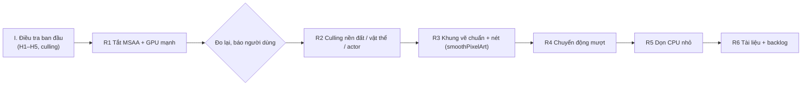

# 06 — Hiệu năng render (GPU), khung vẽ chuẩn, culling và chuyển động mượt — KẾ HOẠCH

> Viết 2026-11-15 theo yêu cầu người dùng: game drop frame, nhân vật chạy giật/lag. **Đây là kế hoạch, chưa triển khai.**
> Mọi giai đoạn chỉ bắt đầu viết mã khi người dùng duyệt; không commit/push nếu không được yêu cầu.
> Nguồn số liệu: trace DevTools `Trace-20261114T210657.json` (8,1 s, Chrome trên Mac, `hostDPR = 2`).
> Liên quan: [02-do-luong.md](02-do-luong.md) (PF1), [03-gioi-han-bo-nho-texture.md](03-gioi-han-bo-nho-texture.md) (PF2),
> [../formulas/speed.md](../formulas/speed.md) (vận tốc/FPS, bắt buộc đọc trước R4), [../formulas/effects.md](../formulas/effects.md) (làm chậm/băng sát ảnh hưởng vận tốc).

## 0. Quyết định của người dùng (2026-11-15)

| # | Câu hỏi | Trả lời |
|---|---|---|
| 1 | Đổi quy tắc 1:1 thành "1 px ảnh = 1 px khung, phóng mờ bằng CSS"? | **Không.** Hình phải **nét nhất có thể**, tối thiểu không quá mờ |
| 2 | Điện thoại ngang | **Tạm bỏ qua** |
| 3 | Thứ tự | Theo khuyến nghị: **điều tra + R1 → đo → mới làm các bước sau** |
| 4 | Dev tool (gallery, skill-lab, maptest, bots UI) | **Không áp dụng**, giữ nguyên (chỉ dùng để test) |
| — | Khung vẽ chuẩn | 1024×768 · 1180×820 · 1280×800 · 1366×768; tự chọn theo tỉ lệ cửa sổ, ghi đè được trong Tùy chỉnh; lấp đầy theo tỉ lệ (viền đen tối thiểu); HUD bám khung; giữ zoom 100/150/200 % trong khung |
| — | Culling | Kiểm tra ban đầu cả **nền đất, vật thể bản đồ và quái/nhân vật** (frustum / backface / occlusion) |

## 1. Số liệu từ trace (đã đo)

| Chỉ số | Giá trị |
|---|---|
| FPS | 139 frame / 8,1 s ≈ **17 FPS**; khoảng rAF trung vị **58 ms**, p95 62 ms; 135/138 frame > 33 ms |
| JS mỗi frame | trung vị **2,45 ms**, p95 2,8 ms; main thread bận 11 % (CPU profile 7 277 ms idle) |
| GC | 4 MinorGC, tổng 2,5 ms |
| Long task | 1 task 274 ms đầu trace = `CpuProfiler::StartProfiling` (do DevTools, không phải lỗi game) |
| GPU process `CrGpuMain` | bận **98 %** (7 978 / 8 120 ms); tab game 7 466 ms ≈ **57 ms GPU mỗi frame**, mọi frame |
| Bộ nhớ GPU tab game | **480 MB** → 290 MB trong trace |
| Lệnh WebGL phía JS | `drawElements`, `bufferSubData`, `texImage2D`… tổng < 30 ms / 8 s → ít draw call, ít upload |
| CPU nhỏ đáng dọn | `drawPlate` 25 ms, `floatText` 19 ms (có `getImageData`), `console.log` tốc độ 28 lần |

Kết luận đo được: **GPU-bound** — chi phí tỉ lệ theo số pixel/sample phải vẽ, không theo số lệnh JS.

## 2. Giả thuyết cần xác minh (chưa chứng minh)

| Mã | Giả thuyết | Căn cứ trong mã | Mức tin |
|---|---|---|---|
| **H1** | Canvas vẽ ở độ phân giải thiết bị (Retina = 4× pixel) **và** Phaser bật mặc định **MSAA 4x** (`antialiasGL: true`) → GPU quá tải, VRAM cao | [game/index.ts](../../apps/client/src/game/index.ts) `scale.width = innerWidth * DPR`, không có khối `render`; Phaser 4.2.1 `Config.js:362` mặc định `antialiasGL = true`; `WebGLRenderer.js:91` tạo context `antialias: antialiasGL`, `depth: true` | Cao |
| **H2** | `powerPreference: 'default'` → Mac 2 GPU có thể chạy GPU tích hợp | `Config.js` mặc định `'default'` | Trung bình |
| **H3** | Không cull theo khung nhìn: **nền đất** (region 512×512) giữ tới 1 400 px ngoài màn hình vẫn vẽ; **quái/nhân vật/NPC ngoài màn hình vẫn update + vẽ mỗi frame** và **tải sheet** (đẩy VRAM) | [MapView.ts](../../apps/client/src/game/map/MapView.ts) `cull()` chỉ xử lý object pieces; `GROUND_KEEP = 1400`. [WorldScene.update](../../apps/client/src/game/WorldScene.ts) gọi `view.update()` cho **mọi** actor; `JxSprite.render` luôn `setVisible(true)` + `request()` sheet. Phaser 4 `GameObject.willRender` **không** kiểm tra biên camera. Server không có interest management (BACKLOG HT5) → client nhận mọi actor của bản đồ | Cao (về mã) / chưa đo mức ảnh hưởng |
| **H4** | Chạy giật do vị trí hiển thị đuổi theo server bằng `exp` trong khi patch chỉ 20 Hz → vận tốc hiển thị dao động "nhanh–chậm" | [ActorView.update](../../apps/client/src/game/actors/ActorView.ts) `k = 1 - exp(-dt*14)`; `MapRoom.ts` `setPatchRate(TICK_MS)`, `TICK_RATE = 20` | Cao |
| **H5** | Camera lerp theo **frame** chứ không theo thời gian → lệch nhịp với nhân vật, rõ hơn ở FPS thấp; `roundPixels` gây rung 1 px | [WorldScene.ts](../../apps/client/src/game/WorldScene.ts) `startFollow(anchor, true, 0.15, 0.15)` | Cao |

## 3. Giai đoạn



| GĐ | Nội dung | Rủi ro | Mốc dừng duyệt |
|---|---|---|---|
| I | Điều tra, đo mốc, xác minh H1–H5, kiểm tra culling | Không đổi hành vi (chỉ cờ dev tạm) | Báo cáo số liệu |
| R1 | `antialiasGL: false`, `powerPreference: 'high-performance'` | Thấp | Đo lại → người dùng duyệt R2 |
| R2 | Culling nền đất, vật thể, actor; giới hạn tải sheet ngoài màn hình | Thấp–trung bình | Đo lại |
| R3 | Khung vẽ chuẩn, render scale theo ngân sách, smoothPixelArt, HUD bám khung | **Cao** (dựng hình, HUD, input) | Ảnh so sánh + đo |
| R4 | Nội suy snapshot, dự đoán self, camera theo `dt` | Trung bình | Video/trace chạy thẳng |
| R5 | Thanh máu, floatText, log | Thấp | — |
| R6 | AGENTS, docs, BACKLOG/CURRENT/HISTORY | — | — |

---

## 4. Giai đoạn I — Điều tra ban đầu (bắt buộc trước khi sửa)

Chuẩn bị chung:
- Chạy server thử nghiệm cổng **2568 / 5174** (cách làm `tasks/CURRENT.md` mục 5); **không** dùng 2567 / 5173 của người dùng.
- `gitnexus analyze` (index đang chậm 16 commit), sau đó `impact` cho `ActorView.update`, `WorldScene.update`, `MapView.update/cull`, `JxSprite.render`, `display.ts:DPR/ui` để biết phạm vi.
- Kịch bản đo cố định 8 s: đứng 2 s → chạy thẳng 4 s → đánh quái 2 s; Biện Kinh (map 37) và một bãi luyện công đông quái; fullscreen Retina + một màn DPR 1 (1920×1080). Thêm một lần với bots đông (`npm run bots`, BT7).
- Cờ thử nghiệm **chỉ dev, tạm thời** qua query (xóa hoặc giữ sau cờ `import.meta.env.DEV`): `?msaa=0|1`, `?dpr=1`, `?power=high|low|default`, `?cull=0|1`, `?perfhud=1`.

### I.1 Xác minh H1/H2 (MSAA, độ phân giải, GPU)
1. Ghi trong console khi khởi động (dev): `gl.getContextAttributes()` (antialias, depth, stencil), `gl.getParameter(gl.SAMPLES)`, kích thước drawing buffer, `WEBGL_debug_renderer_info` (GPU đang dùng). Đối chiếu `chrome://gpu`.
2. Ma trận A/B, mỗi ô một trace 8 s: `msaa 1/0` × `dpr thật/1` × `power default/high`.
3. Đo mỗi ô: khoảng rAF trung vị/p95, `CrGpuMain` busy/frame cho tab game, GPU memory (`GPUTask.args.data.used_bytes`), JS/frame. Dùng lại script phân tích (`analyze.py`, `gpu.py`, `frame.py` — chép vào `tools/perf/trace/` nếu người dùng muốn giữ).
4. **Kết luận chấp nhận H1** nếu `msaa=0` giảm GPU/frame ≥ 40 % ở cùng độ phân giải; tách được phần do độ phân giải nhờ ô `dpr=1`.

### I.2 Kiểm tra culling (nền đất, vật thể, quái/nhân vật)
Ba loại culling thường gặp và cách áp vào game 2D isometric này:

| Loại | Ý nghĩa | Áp dụng ở đây | Việc kiểm tra |
|---|---|---|---|
| **Frustum culling** (ngoài tầm camera) | Chỉ vẽ thứ giao với khung nhìn camera | **Có giá trị.** Trong 2D, "frustum" = hình chữ nhật `camera.worldView` (+ lề). Phaser 4 **không** tự cull game object theo biên (`willRender` chỉ xét cờ/visible/camera filter) | Đếm số object được submit mỗi frame vs số nằm trong khung nhìn (xem dưới) |
| **Backface culling** (mặt sau) | Bỏ mặt sau đa giác 3D | **Không áp dụng**: mọi thứ là quad 2D luôn quay mặt về camera; Phaser không bật `CULL_FACE` và không cần | Chỉ ghi nhận, không làm |
| **Occlusion culling** (bị che khuất) | Bỏ phần bị nhà/vách che hoàn toàn | **Giá trị thấp, khó**: sprite có alpha, vẽ theo thứ tự depth (painter's), không có depth test sớm; nhà che đất chỉ một phần màn hình. Có thể tiết kiệm fill-rate cho nền đất dưới mảng nhà lớn đặc | Đo **overdraw** trước; chỉ đề xuất nếu overdraw trung bình > ~3× sau R1–R3 |

Đo cụ thể (dev overlay `?perfhud=1`, cập nhật 2 lần/giây):
- **Nền đất:** số region đã tải / số đang `visible` / số giao `worldView`. Hiện `GROUND_LOAD = 384`, `GROUND_KEEP = 1400` px → ước tính lý thuyết: khung 3456×2234 world px (Retina hiện tại) có thể giữ tới ~(3456+2800)/512 × (2234+2800)/512 ≈ 13 × 10 region, trong khi chỉ ~8 × 6 giao màn hình. Xác nhận bằng số thật.
- **Vật thể bản đồ (object pieces):** tổng piece đã tạo / `visible` sau `cull()`; kiểm tra ngưỡng chỉ cull lại khi camera dịch ≥ 24 px có để lọt piece ở mép không.
- **Actor (quái, người chơi, NPC, đồ rơi, hiệu ứng):** tổng `views` / số trong khung nhìn / số image Phaser đang visible (mỗi người chơi = nhiều lớp paper-doll + bóng + tên + thanh máu + StateDecor) / thời gian `ActorView.update` tổng. Ghi số **sheet đã tải** (`jx:*` textures) và ước tính VRAM của chúng → liên hệ 480 MB.
- **Ước lượng overdraw:** tổng diện tích (w×h) các quad visible trong khung nhìn ÷ diện tích khung nhìn, tách theo nhóm (đất, vật thể, actor, chữ, hiệu ứng).
- **A/B:** `?cull=1` thử tạm cull actor + ground ngoài khung nhìn (chỉ dev) → so GPU/frame, JS/frame, VRAM.

### I.3 Xác minh H4/H5 (chuyển động)
- Dev log mỗi frame cho self (ring buffer, xuất CSV qua console): `t`, vị trí server mới nhất + thời điểm patch đến, vị trí hiển thị, vận tốc hiển thị, vị trí camera.
- Vẽ đồ thị (script scratch): vận tốc hiển thị theo thời gian khi chạy thẳng ở tốc nền 100 % (120 px/s theo `speed.md` §14) và khi cưỡi ngựa (360 px/s). **Kết luận H4** nếu vận tốc dao động có chu kỳ ~50 ms, biên độ > 20 %.
- So độ lệch camera–nhân vật ở 60 FPS và ở 17 FPS giả lập (DevTools CPU throttle hoặc `?msaa=1` trên Retina). **Kết luận H5** nếu độ trễ camera phụ thuộc FPS.
- Đo khoảng thời gian giữa các patch đến client (jitter mạng localhost vs mạng thật).

### I.4 Đầu ra giai đoạn I
Bảng kết quả ghi vào `02-do-luong.md` mục mới "Render GPU" + cập nhật mục 2 của tài liệu này (giả thuyết nào đúng, mức ảnh hưởng). **Dừng, báo người dùng.**

---

## 5. R1 — Tắt MSAA, chọn GPU mạnh

[game/index.ts](../../apps/client/src/game/index.ts):
```ts
render: {
  antialiasGL: false,              // MSAA vô ích với ảnh 1:1, roundPixels
  antialias: true,                 // giữ lọc LINEAR như hiện tại (zoom 150/200 % không đổi; cần cho smoothPixelArt ở R3)
  powerPreference: 'high-performance',
},
```
- Không bật `pixelArt` (đổi sang NEAREST) và **không** bật `smoothPixelArt` toàn cục (Phaser ép `antialiasGL = true` khi bật — `Config.js` ~dòng 409).
- `stencil`: giữ; chỉ tắt nếu grep `setMask|createGeometryMask|createBitmapMask|Mask` cho thấy không dùng (việc phụ).
- Kiểm chứng: trace kịch bản I; ảnh chụp Playwright 100/150/200 % trước–sau → sprite trùng pixel, chỉ cạnh Graphics (vòng cổng, thanh máu) được phép khác.
- Nền tảng: Web/Desktop hưởng trực tiếp; Mobile (tạm bỏ qua) cũng có lợi.

## 6. R2 — Culling nền đất, vật thể, quái/nhân vật (frustum 2D)

Chỉ làm phần nào giai đoạn I chứng minh có ảnh hưởng.

### R2.1 Nền đất — [MapView.ts](../../apps/client/src/game/map/MapView.ts)
- Thêm ground region vào `cull()`: `image.visible` = giao `worldView + CULL_MARGIN`.
- Giữ tải/nhả theo `GROUND_LOAD`/`GROUND_KEEP` (đó là streaming, khác với vẽ); xem lại `GROUND_KEEP = 1400` theo khung mới ở R3 (khung nhỏ hơn → có thể giảm, nhả VRAM sớm hơn).
- Nền đất **đã là chunk 512×512** (không phải một mesh khổng lồ) nên frustum culling theo region là đủ; không cần chia nhỏ hơn.

### R2.2 Vật thể bản đồ
- Giữ `cull()` hiện tại; kiểm tra ngưỡng 24 px + `CULL_MARGIN = 96` theo kết quả I.2 (không lọt piece ở mép khi chạy nhanh / cưỡi ngựa 360 px/s).
- Cân nhắc lưới không gian theo chunk để `cull()` không duyệt mọi piece khi map dày (chỉ nếu đo thấy tốn).

### R2.3 Quái / nhân vật / NPC / đồ rơi — [WorldScene.ts](../../apps/client/src/game/WorldScene.ts), [ActorView.ts](../../apps/client/src/game/actors/ActorView.ts), [PaperDoll.ts](../../apps/client/src/game/actors/PaperDoll.ts)
- Mỗi frame tính `inView = worldView` nới lề (≈ 160 px + chiều cao figure) một lần.
- Actor ngoài khung: **vẫn cập nhật vị trí logic** (nội suy R4, minimap, chọn mục tiêu, âm thanh) nhưng **bỏ** `renderSprite`, `drawPlate`, `StateDecor`, đặt `visible = false` cho mọi image/text/graphics của nó.
- **Không yêu cầu sheet** (`requestSheets`) cho actor ngoài khung (trừ self) → giảm VRAM, liên kết PF2 (`TextureCache` LRU nhả sheet không dùng).
- Khi actor quay lại khung: hiện ngay pose đã có, tải pose thiếu như hiện tại (fallback `stand`).
- Đồ rơi (`GroundView`), hiệu ứng chiêu (`SkillFx`), số sát thương: ẩn khi ngoài khung (hiệu ứng ngắn có thể bỏ qua nếu đo không đáng).
- Server interest management (HT5) là việc riêng, giảm số actor client nhận — ghi nhận, không làm ở đây.

### R2.4 Occlusion culling
- **Không triển khai** trừ khi đo overdraw sau R1–R3 vẫn cao. Nếu cần: đánh dấu offline (tool `gen:maps`) các vùng nhà/vách **đặc hoàn toàn** và bỏ vẽ region đất nằm trọn dưới chúng — cần duyệt riêng vì đụng tool sinh asset.

### R2.5 Kiểm chứng
- Overlay I.2: số object visible ≈ số trong khung; GPU/frame, JS/frame, VRAM giảm ở bãi đông quái.
- Không có pop-in ở mép khi chạy/cưỡi ngựa, khi zoom đổi, khi dịch chuyển bản đồ.
- Auto/target/minimap/âm thanh vẫn đúng với actor ngoài khung.

## 7. R3 — Khung vẽ chuẩn, giữ hình nét

### R3.1 Mô hình render (đáp ứng "nét nhất có thể")
Thay vì vẽ ở khung nhỏ rồi phóng mờ bằng CSS, **khung chuẩn chỉ quyết định vùng thế giới nhìn thấy**; GPU vẽ trực tiếp ở độ phân giải hiển thị (tới ngân sách), dùng shader `smoothPixelArt` của Phaser 4 **theo từng texture** để pixel ảnh giữ cạnh sắc khi phóng hệ số lẻ.

Định nghĩa:
- `devW = innerWidth × DPR`, `devH = innerHeight × DPR` (pixel thiết bị của cửa sổ).
- Khung `W×H` = khung chuẩn có `|ln(tỉ lệ cửa sổ ÷ tỉ lệ khung)|` nhỏ nhất (hoặc khung người chơi chọn).
- `fit = min(devW / W, devH / H)` = số pixel thiết bị cho mỗi pixel thế giới khi lấp đầy.
- **Cửa sổ nhỏ hơn khung (`fit < 1`)**: giữ đúng như hiện nay — vẽ 1:1, vùng nhìn = cửa sổ (cắt bớt, không thu nhỏ → không mờ).
- **Ngược lại**: `r = min(fit, rBudget)`, `rBudget = √(BUDGET ÷ (W·H))`; nếu `rBudget < fit` và `rBudget − ⌊rBudget⌋ < 0,25` thì lấy `r = ⌊rBudget⌋` (phóng nguyên lần, nét tuyệt đối).
- Canvas backing = `round(W·r) × round(H·r)`; camera zoom = `r × zoomStep` (100/150/200 %); `worldView = W×H ÷ zoomStep`.
- CSS phóng phần còn lại `fit ÷ r` (≥ 1) **chỉ khi vượt ngân sách**; khi đó nguồn đã ≥ 2× nên chỉ hơi mềm.
- Mọi texture ảnh gốc (`jx:*`, map ground/objects, icon, hiệu ứng): `texture.setSmoothPixelArt(true)` qua sự kiện thêm texture (`textures.on('addtexture', …)`); Phaser 4 đọc cờ theo texture (`SubmitterQuad.js` ~dòng 311) và luôn lấy extension `OES_standard_derivatives` (`WebGLRenderer.js:894`). Ở `r` nguyên và vị trí nguyên, kết quả trùng ảnh nhân pixel → cần kiểm chứng bằng diff ảnh.
- Chữ Phaser (`Text`: tên, số sát thương, nhãn đồ rơi, cổng): `setResolution(r)` để chữ vẽ đúng độ phân giải; Graphics là vector nên tự nét.

Ngân sách (Tùy chỉnh "Chất lượng đồ hoạ"; số chốt lại bằng đo ở I/R1):

| Mức | `BUDGET` (pixel backing) | Ghi chú |
|---|---|---|
| Thấp | ~1,1 Mpx (r ≈ 1) | máy yếu |
| **Cân bằng (mặc định)** | ~4,2 Mpx (1366×768 × 2²) | |
| Cao | ~8,3 Mpx (≈ 4K) | |
| Tối đa | không giới hạn | luôn vẽ đủ độ phân giải hiển thị, không phóng CSS |

Ví dụ (Cân bằng):

| Màn hình (cửa sổ trình duyệt) | Khung | `fit` | `r` | Backing | Phóng CSS | So với hiện tại |
|---|---|---|---|---|---|---|
| 1366×768 DPR 1 (cửa sổ ~1366×657) | 1366×768 | 0,86 | 1 (nhỏ hơn khung) | 1366×657 | 1 | giống hệt |
| 1920×1080 DPR 1 (~1920×969) | 1366×768 | 1,26 | 1,26 | 1724×969 (1,7 Mpx) | 1 | smoothPixelArt, không MSAA |
| MacBook 1728×1117 DPR 2 | 1280×800 | 2,70 | 2 | 2560×1600 (4,1 Mpx) | 1,35 | hiện 7,7 Mpx × MSAA 4 |
| 4K 3840×2160 (~3840×1940) | 1366×768 | 2,53 | 2 | 2732×1536 (4,2 Mpx) | 1,26 | hiện 7,4 Mpx × MSAA 4 |
| 8K 7680×4320 (~7680×4100) | 1366×768 | 5,34 | 2 | 2732×1536 | 2,67 (mềm hơn; chọn Cao/Tối đa nếu GPU mạnh) | hiện 31 Mpx × MSAA 4 |

> [!NOTE]
> Khung chuẩn nghĩa là mọi người chơi thấy cùng vùng thế giới. Trên màn lớn, ảnh gốc hiển thị **to hơn hiện nay** (vd. Retina ~2,7 pixel thiết bị / pixel ảnh) — đó là bản chất của yêu cầu "chỉ vẽ theo khung chuẩn". Độ nét được giữ bằng smoothPixelArt + phóng nguyên lần khi có thể, không phóng mờ toàn ảnh.

### R3.2 Phaser scale — [game/index.ts](../../apps/client/src/game/index.ts), [game/display.ts](../../apps/client/src/game/display.ts)
- `display.ts`: `VIEWPORTS`, `pickViewport()`, `computeRender(win, DPR, settings) → { W, H, r, cssScale, small }`; `ui(px)` đổi thành pixel thế giới (camera zoom `r` lo phần thiết bị); giữ `DPR` cho canvas 2D trong HUD.
- `index.ts`: `Scale.NONE`, `width/height` = backing, `zoom` = `fit ÷ (r × DPR)` (CSS px mỗi pixel backing), `autoCenter: CENTER_BOTH`; khi resize/đổi setting → `scale.resize()` + đặt lại zoom camera + `Text.setResolution`. Phaser quy đổi pointer theo `displayScale` (kiểm chứng; rà `clientX|pointer.x` trong `game/`).
- `WorldScene.applyZoom` và `MapView.ready()` dùng `cam.width / cam.zoom` → vẫn đúng; kiểm tra lại.

### R3.3 HUD bám khung — `ui/hud/hud.css`, `Hud.ts` (hoặc `ui/kit/viewport.ts` mới)
- `#hud` đặt đúng hình chữ nhật canvas (từ `game.scale.canvasBounds`), dàn trang ở `W×H` CSS px, `transform: scale(fit ÷ DPR)`, `transform-origin: 0 0`. Trình duyệt raster lại chữ HTML ở tỉ lệ cuối → chữ nét (kiểm chứng).
- Dialog kéo thả `.dlg`, tooltip, menu nổi: giới hạn trong `#hud`, toạ độ chuột chia hệ số phóng.
- Media query trong CSS HUD (vd. `vitals.css`) → điều kiện theo khung (class trên `#hud`).
- Minimap/bigmap canvas 2D: backing = kích thước CSS × DPR × hệ số phóng để vẫn nét.
- Màn đăng nhập/chọn nhân vật (`#ui` screens) giữ toàn cửa sổ.

### R3.4 Tùy chỉnh — `state/settings.ts`, cửa sổ Hệ thống
- "Khung hình": Tự động (mặc định) / 1024×768 / 1180×820 / 1280×800 / 1366×768.
- "Chất lượng đồ hoạ": Thấp / Cân bằng (mặc định) / Cao / Tối đa. Đổi → áp ngay.

### R3.5 Phạm vi loại trừ
- Dev scene `GalleryScene`, `SkillLabScene`, `/maptest.html`, `tools/bots` UI: **giữ nguyên** (quyết định 4).
- Điện thoại: tạm bỏ qua (quyết định 2); iPad dùng được khung 1024×768/1180×820 nhưng chưa thử cảm ứng.

### R3.6 Kiểm chứng
- Playwright cửa sổ 1024×768, 1180×820, 1280×800, 1366×768, 1920×1080 (DPR 1/2), 2560×1440, 3840×2160, 900×600: khung đúng, viền đen tối thiểu, HUD nằm trong khung.
- Ảnh so sánh độ nét: ở `r` nguyên diff = 0 so với nhân pixel; ở `r` lẻ không mờ toàn ảnh (đối chiếu bằng mắt người dùng).
- Click đúng quái/NPC/đồ rơi, click minimap, kéo thả Hành trang/Rương sau khi phóng.
- Trace: backing ≤ ngân sách; GPU/frame < 8 ms trên máy test.
- `npm run typecheck`, `npm run build`.

## 8. R4 — Chuyển động mượt

Đọc toàn bộ [speed.md](../formulas/speed.md) và [effects.md](../formulas/effects.md) trước khi làm (vận tốc chạy, sải chân, làm chậm/băng sát).

1. **Bộ đệm snapshot cho actor khác/quái** — module mới `game/actors/Interp.ts`: lưu `(t, x, y)` khi state đổi; hiển thị ở `now − 100 ms` (2 patch 20 Hz), nội suy tuyến tính; thiếu dữ liệu > 250 ms → giữ hoặc ngoại suy ngắn; nhảy > 400 px → teleport (giữ hành vi hiện tại).
2. **Self** — dead-reckoning theo hướng di chuyển và vận tốc `velocity = FPS ÷ referenceFrames × stridePixels` (speed.md §14, gồm `moveScale`, ngựa, làm chậm), hiệu chỉnh mềm về vị trí server khi lệch > ~24 px, lệch lớn → snap. **Server vẫn quyết định** (AGENTS §5.3); client chỉ làm đẹp hiển thị.
3. **Camera** — lerp theo thời gian `l = 1 − (1 − 0.15)^(dt·60)` hoặc follow cứng sau khi self đã mượt; làm tròn vị trí camera một lần (tránh rung 1 px giữa camera và sprite).
4. **Kiểm chứng** — log I.3 lặp lại: vận tốc hiển thị dao động < 10 % khi chạy thẳng; thử 60/120 Hz và 17 FPS giả lập; đánh quái, bị đẩy lùi, Khinh công, dịch chuyển bản đồ, làm chậm.

## 9. R5 — Dọn CPU nhỏ

| Việc | File |
|---|---|
| Thanh máu: chỉ vẽ lại khi `ratio/pk/zoom` đổi; di chuyển bằng `bar.setPosition()` (bỏ `x` khỏi `barKey`) | `ActorView.drawPlate` |
| Số sát thương: pool `Text` (hoặc `BitmapText`), truyền `metrics` cố định để bỏ `MeasureText/getImageData` | `fx/Effects.ts` |
| Log tốc độ/đòn đánh (`runTrace`/`attackTrace`) chỉ khi bật cờ dev | `ActorView.ts` |

## 10. R6 — Tài liệu & theo dõi
- `AGENTS.md` §5.5: viết lại quy tắc theo mô hình R3.1 (vẫn ưu tiên nét: khung chuẩn quyết định vùng nhìn; vẽ ở độ phân giải hiển thị tới ngân sách, smoothPixelArt; cửa sổ nhỏ vẫn 1:1) — **cần người dùng duyệt câu chữ**.
- `docs/ui-and-platforms.md` (khung, HUD bám khung, Tùy chỉnh), `docs/architecture.md` (module mới), `docs/performance/README.md` (thêm dòng 06), `02-do-luong.md` (số liệu trước/sau).
- `tasks/BACKLOG.md` §9: thêm PF10 (I + R1), PF11 (R2 culling), PF12 (R3 khung vẽ), PF13 (R4 chuyển động), PF14 (R5); cập nhật `CURRENT.md`, `HISTORY.md`.

## 11. Rủi ro & lưu ý
- smoothPixelArt theo texture là tính năng Phaser 4 mới: cần spike nhỏ ở đầu R3 (một sprite, một ground region) trước khi áp toàn bộ.
- Chữ Phaser `setResolution(r)` tăng VRAM chữ theo `r²` — số lượng ít, chấp nhận; theo dõi bằng overlay.
- Cull actor ngoài khung không được làm sai Auto/target (logic dùng state, không dùng visible) — kiểm thử theo `docs/auto.md`.
- Ngân sách và lề cull là số đề xuất; chốt bằng số đo giai đoạn I.
